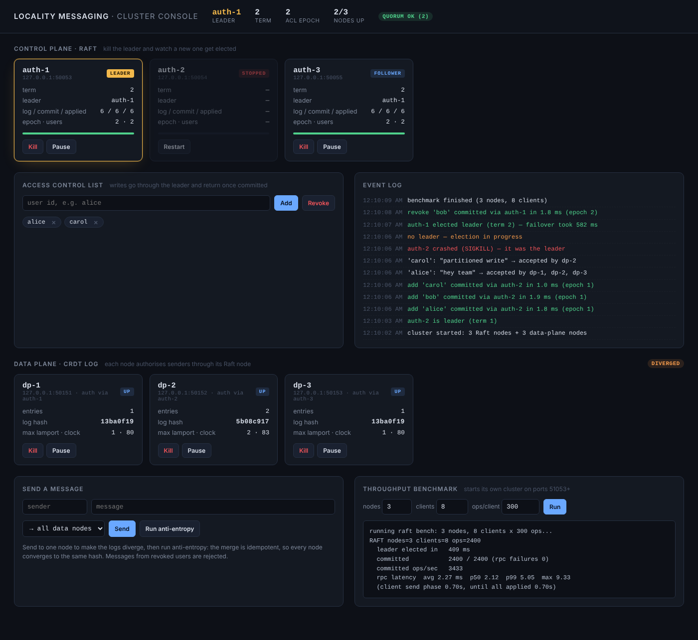

# Locality-Based Messaging System

Distributed Systems Project — Raft + CRDT Data Plane

---

## Overview

This project implements a distributed messaging system that combines strong consistency (Raft control plane), eventual consistency (CRDT data plane), secure message enforcement (ACL + epochs), and fault tolerance with recovery.

The system demonstrates real-world distributed systems principles including consensus via Raft, log replication, failure recovery, concurrency, and performance benchmarking.

---

## v2 — Performance, Reliability & Dashboard (extensions by Narayan)

Work done on this fork after the course submission. Every number below is
measured with `bench/tput_bench`, running both versions back-to-back on the same
machine (2 vCPU Ubuntu 24.04 VM, all nodes on localhost).

### Results

**Control plane (Raft). Committed ACL writes/sec**: the clock stops only when
every write is applied on the leader, so this measures real consensus.

| Cluster | Clients | Before (ops/s) | After (ops/s) | Speed-up | p99 latency before → after |
|---|---|---|---|---|---|
| 3 nodes | 1  | ~1,030 | ~1,700 | 1.7× | 13 ms → 1.8 ms |
| 3 nodes | 8  | ~1,050 | ~3,300 | **3.2×** | 28 ms → 5.5 ms |
| 3 nodes | 32 | ~725   | ~4,250 | **5.9×** | 204 ms → 17 ms |
| 5 nodes | 8  | ~625   | ~2,480 | **4.0×** | 43 ms → 7 ms |
| 7 nodes | 8  | ~520   | ~1,900 | **3.7×** | 48 ms → 9 ms |

> The old `AddUser` returned *before* the entry was committed, so its latency did
> not include consensus at all. The new version replies only after a majority has
> the entry and the leader has applied it. It is still faster.

**Data plane (CRDT log). SyncLogs merge throughput**, 4 peers × 200 batches × 100 msgs (80k messages):

| | Before | After |
|---|---|---|
| merged msgs/sec | ~4,600 | **~99,000 (≈21×)** |
| SyncLogs p99    | 397 ms | 12 ms |

**Fault tolerance** (`bench/failover_test.py`): 4 clients write continuously while
the leader is SIGKILLed and restarted, then the *whole cluster* is killed and
restarted from disk. Result: **0 of ~8,500 acknowledged writes lost** (3- and 5-node
clusters). Leader failover takes ~0.5 s (election timeout 300–600 ms).

### What changed

Control plane (`src/raft_node.cpp`)
- **One replication thread per peer** instead of a detached `std::thread` per peer on every
  heartbeat and every proposal. Each peer has one AppendEntries in flight. Everything proposed
  meanwhile goes out in the next RPC (**batching / group commit**, up to 1024 entries).
- **Commit-wait**: `AddUser`/`RevokeUser` return `success=true` only once committed and applied.
  `RevokeUser` now returns the real new epoch.
- **Raft log persisted** (`raft_log_<id>.bin`), plus term, vote and an ACL snapshot (atomic
  write via tmp + rename). Before this, only term/vote/users were saved and the log was lost on
  restart. Set `RAFT_FSYNC=1` to fdatasync every append.
- **Deadlines on every RPC**, and gRPC reconnect back-off capped at 250 ms, so a restarted
  node rejoins without forcing a needless election.
- **Fast log back-off**: on mismatch the follower returns a conflict index, so the leader jumps
  back a whole term at once instead of one entry per round-trip.
- **No-op entry on election**, so entries from earlier terms can commit (Raft §5.4.2).
- Election timeout randomized once per reset (it used to be re-rolled every 10 ms tick).
- New RPC `GetStatus`. `AddUser`/`RevokeUser` responses carry a `leader_hint` for redirects.

Data plane (`src/log_store.cpp`, `src/data_plane_service.cpp`)
- **Auth batching + cache**: one `CheckAuthorization` per distinct (sender, epoch) per batch,
  cached for 200 ms (`LBM_AUTH_CACHE_MS`; 0 disables). This used to be one blocking RPC per message.
- **Sorted insert instead of full re-sort**: merge sorts only the new entries and splices them in
  (`O(k log k + n)` instead of `O(n log n)` per sync). Appends take the `O(k)` fast path.
- **Hash index** for O(1) dedup and O(log n) `read()` (both were linear scans).
- **Incremental, order-independent log hash** (FNV-1a based). `get_hash()` is O(1) and stable
  across machines (`std::hash` is not).
- `SyncLogs` no longer copies the whole log to build the summary. Per-message logging is
  behind `LBM_VERBOSE`.
- Epoch handling fixed: entries with a *future* epoch are rejected, and the data plane advances its
  epoch to what Raft has authorised (previously `test_acl` failed).
- `lamport_time` is no longer truncated to `int32` in `append()`.

### Live dashboard



```bash
pip install -r ui/requirements.txt
python3 ui/dashboard.py --nodes 3            # add --host 0.0.0.0 to open it from outside the VM
# open http://localhost:8080
```

It starts N Raft nodes + N data-plane nodes and shows role, term, commit index and epoch live.
You can kill, restart or pause any node (failover time is logged), add or revoke users,
send messages to one or all data nodes to watch the CRDT logs diverge and converge, and run
the throughput benchmark.

### Benchmarks & tests

```bash
./build/tput_bench raft 3 8 300        # nodes, clients, ops per client
./build/tput_bench dp 100 200 4        # batch size, batches, clients
python3 bench/failover_test.py 3 6     # nodes, seconds
./build/all_tests && ./test_raft_local.sh && ./build/full_system_test
```

### Known trade-offs

- **Revocation vs. convergence**: auth is checked at merge time against the *current* ACL, so a
  message accepted before a revoke can be rejected by nodes that receive it later. Logs can then
  legitimately differ. (`test_raft_rpcs` requires that old-epoch messages from revoked users are
  denied.) Proper fix: sign messages and validate against the epoch they were created in.
- Merge throughput drops for very large logs when concurrent peers interleave in Lamport order
  (mid-log inserts are O(n)). A chunked/B-tree log would fix it.
- No pre-vote, so a node coming back from a long pause can still trigger an election.
- The auth cache lets a revoked user sync for up to `LBM_AUTH_CACHE_MS` after revocation.

---

## Architecture

```
                +--------------------+
                |      Clients       |
                +--------+-----------+
                         | RPC
                         v
         +-------------------------------+
         |   Control Plane (Raft)        |
         |   - Leader election           |
         |   - Ordered log               |
         |   - ACL management            |
         +--------+----------------------+
                  | Apply
                  v
         +-------------------------------+
         |   Data Plane (LogStore)       |
         |   - Append-only log           |
         |   - Lamport ordering          |
         |   - CRDT merge                |
         +--------+----------------------+
                  |
                  v
         +-------------------------------+
         |   SyncLogs (Gossip)           |
         |   - Anti-entropy              |
         |   - Recovery                  |
         +-------------------------------+
```

---

## Components

### Data Plane (Narayan)

- `LogStore` — append-only log with mutex-protected operations
- Lamport clock ordering with atomic increment and update
- CRDT merge using set-union semantics
- Deterministic, incremental log hashing (FNV-1a)

### Control Plane (Raft)

- Leader election with randomised timeouts
- Log replication across nodes
- Commit index tracking
- State machine execution for ACL mutations

### Authorization (IntegrationAuth)

- Per-message validation on every gossip batch
- Epoch-based revocation — revoked members cannot inject messages
- Secure enforcement of ACL rules at merge time

---

## Project Structure

```
locality_based_messaging/
├── include/
│   ├── log_store.h
│   ├── lamport_clock.h
│   └── log_entry.h
├── src/
│   ├── log_store.cpp
│   ├── lamport_clock.cpp
│   ├── log_server.cpp
│   ├── log_client.cpp
│   ├── fake_auth_server.cpp
│   ├── partition_sim.cpp
│   ├── latency_bench.cpp
│   ├── crash_sim.cpp
│   └── correctness_eval.cpp
├── tests/
│   ├── test_log_store.cpp
│   ├── test_lamport_clock.cpp
│   ├── test_grpc_integration.cpp
│   └── test_full_system.cpp
├── app/
│   ├── latency.cpp
│   └── tput.cpp
├── bench/
│   ├── latency_plot.py
│   └── lat-tput.py
├── proto/
│   └── locality_messaging.proto
└── CMakeLists.txt
```

---

## Build Instructions

```bash
cmake -S . -B build
cmake --build build -j$(nproc)
```

---

## Running the System

Start manually:

```bash
./build/fake_auth_server 127.0.0.1:50060
./build/raft_server node-1 127.0.0.1:50053 node-2=127.0.0.1:50054 node-3=127.0.0.1:50055
./build/raft_server node-2 127.0.0.1:50054 node-1=127.0.0.1:50053 node-3=127.0.0.1:50055
./build/raft_server node-3 127.0.0.1:50055 node-1=127.0.0.1:50053 node-2=127.0.0.1:50054
./build/log_server node-1 0.0.0.0:50051 127.0.0.1:50053
```

Run automated tests:

```bash
ctest --test-dir build -V
```

---

## Testing

### Unit Tests

- Lamport clock correctness — tick, update, concurrent uniqueness
- LogStore append, read, merge, hash, epoch behaviour

### Integration Tests

- gRPC SyncLogs handler
- Per-message auth enforcement
- Data plane correctness under concurrent writes

### Full System Test

- Raft leader election
- ACL add and revoke via Raft
- Crash recovery with re-election
- Auth enforcement after revocation

---

## Performance Evaluation

### Latency Benchmark

```bash
./build/latency_bench
```

Measures 1000 sequential operations across 5 runs, reporting average, min, and max latency.

### Throughput Benchmark

```bash
./build/tput_bench raft <nodes> <clients> <ops_per_client>
./build/tput_bench dp <batch> <batches> <clients>
```

Measures committed ops/sec and latency percentiles (P50, P99) across concurrent clients and cluster sizes.

### Graph Generation

```bash
python3 bench/latency_plot.py
python3 bench/lat-tput.py
```

### Sample Results

| Metric      | Value                          |
|-------------|-------------------------------|
| Avg Latency | ~0.6 ms                       |
| P99 Latency | ~8 ms                         |
| Throughput  | ~1600 ops/sec (single client) |

---

## Key Design Decisions

**Lamport Clock.** Each write increments the clock before stamping the entry. On receive, the clock advances to `max(local, received) + 1`, preserving causal ordering without wall-clock synchronisation.

**CRDT Merge.** Set-union semantics with dedup by `message_id`. Entries are sorted by `lamport_time` with `message_id` as tiebreak, ensuring all nodes converge to identical log state regardless of message arrival order.

**Raft Integration.** Raft handles ordering and consensus for ACL mutations. LogStore handles storage and CRDT merge. The two planes are decoupled via the `IntegrationAuth` RPC boundary, allowing independent failure isolation.

**Fault Tolerance.** Crash-stop recovery via gossip resync. Leader re-election continues with a quorum of two nodes after any single node crash. Anti-entropy via `SyncLogs` ensures no entries are permanently lost.

---

## Limitations

- Data-plane log is in-memory only (the Raft log is persisted as of v2)
- Network partitions are simulated (dashboard "pause" = SIGSTOP), not real
- Leader is a throughput bottleneck for write-heavy workloads

---

## Results Summary

- Deterministic convergence verified across 3 nodes
- Correct ACL enforcement before and after revocation
- Stable latency across repeated benchmark runs
- Throughput scales then saturates at expected client concurrency levels

---

## Conclusion

This system demonstrates strong consistency via Raft, eventual consistency via CRDT, robust recovery and fault tolerance, and realistic distributed system performance behaviour measured under both sequential and concurrent workloads.

---

## Future Work

- Persistent storage for the data-plane log
- Raft pre-vote and log compaction
- True network partition simulation
- Dynamic cluster membership changes
- Load balancing reads across replicas
